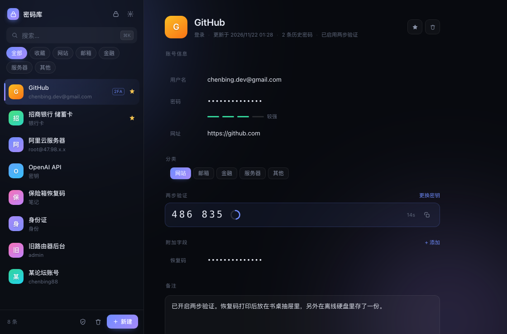

# 密码库（Vault）v1.1

一个完全离线的本地密码管理器。数据只存在你自己的电脑上，不联网、不上传、不需要任何账号。

- 安装包 **2.1 MB**（应用本体 3.6 MB），启动瞬间完成
- 支持 **macOS** 与 **Windows**，同一套代码
- 5 套可切换界面风格
- 所有敏感数据用 **AES-256-GCM** 加密，密钥由主密码经 **PBKDF2-HMAC-SHA256（600,000 次迭代）** 派生
- 加密与文件读写都在 Rust 原生层完成，前端的 JavaScript 拿不到落盘的明文



## 功能

**条目管理**
- 5 种类型：登录、银行卡、身份信息、API 密钥、安全笔记（各自预置好字段）
- 任意自定义字段，可标记为私密（默认打码）
- 分类、收藏、全文搜索（含字段内容）
- 密码历史：改密码时自动留档，最多 10 条
- 回收站：删除先进回收站，可恢复或彻底清除
- 密码强度实时提示

**两步验证（TOTP）**
- 内置验证器，粘贴 Base32 密钥即可，每 30 秒刷新，带倒计时环
- 已通过 RFC 6238 官方 5 组测试向量
- 计算全在本机，密钥随库加密

**密码体检**
- 弱密码、重复使用、超过半年未更新、缺少密码四类问题
- 0–100 评分，点击条目直接跳转修改
- 全部在本机计算，不会把密码发给任何服务（因此不做联网泄露库比对）

**生成器**
- 随机字符模式：长度 8–40，可选大小写/数字/符号，排除易混淆字符（0O1lI）
- 易记短语模式：`山-月-松-岸-42`

**界面**
- 5 套主题：极光（深紫蓝）、石墨（纯黑白）、森野（墨绿）、落日（暖橙）、晨光（浅色）
- 主题在解锁前就生效，切换即时预览

**其他**
- 自动锁定时间可调（1/5/15/30 分钟或关闭）
- 剪贴板自动清除时间可调（15/30/60 秒或关闭）
- 按天自动备份，保留 12 份，可在设置里一键恢复
- CSV 导入（Chrome / Bitwarden / 1Password 等通用表头）、CSV 导出（明文，有二次确认）、加密备份导出
- 键盘导航：`↑` `↓` 切换条目

## 安全设计

| 项目 | 做法 |
| --- | --- |
| 加密算法 | AES-256-GCM（带附加认证数据，防篡改） |
| 密钥派生 | PBKDF2-HMAC-SHA256，600,000 次迭代，每个库独立 16 字节随机盐 |
| 主密码 | 只用于派生密钥，**绝不落盘**，忘记即无法恢复 |
| 内存密钥 | 锁定时主动清零，进程退出即释放 |
| 写盘 | 先写临时文件 + fsync，再原子重命名，避免断电写坏 |
| 自动备份 | 每次保存按天自动留一份，最多保留 12 份 |
| 剪贴板 | 复制密码后按设定时间自动清空 |
| 自动锁定 | 无操作达到设定时长后自动锁定并清空内存数据 |

> 没有后门，也没有恢复码。请务必记牢主密码，并定期导出一份加密备份到别处。

## 数据存放位置

- macOS：`~/Library/Application Support/com.local.vault/vault.dat`
- Windows：`%APPDATA%\com.local.vault\vault.dat`
- 自动备份：上面目录下的 `backups/` 文件夹

`vault.dat` 本身就是密文，可以直接拷到 U 盘或网盘做冷备份。

## 快捷键

| 快捷键 | 功能 |
| --- | --- |
| `⌘/Ctrl + K` | 聚焦搜索 |
| `⌘/Ctrl + N` | 新建条目 |
| `⌘/Ctrl + L` | 立即锁定 |
| `↑` / `↓` | 切换条目 |
| `Esc` | 关闭弹层 / 清空搜索 |
| `Enter`（解锁页） | 解锁 |

## 构建

需要 Node.js 18+ 与 Rust 1.77+。

```bash
npm install

# macOS：产出 .app 与 .dmg
npm run build:mac

# Windows：产出 .exe 安装包（在 Windows 机器上执行）
npm run build:win
```

产物位置：`src-tauri/target/release/bundle/`

> 若 `--bundles dmg` 在较新的 macOS 上失败（Tauri 的 `bundle_dmg.sh` 与新版 `hdiutil` 不兼容），先只打 app，再手动封装：
> ```bash
> npx tauri build --bundles app
> mkdir -p /tmp/d && cp -R src-tauri/target/release/bundle/macos/Vault.app /tmp/d/ && ln -s /Applications /tmp/d/Applications
> hdiutil create -volname Vault -srcfolder /tmp/d -ov -format UDZO Vault.dmg
> ```

Windows 上还需要安装 **Visual Studio 生成工具（C++ 桌面开发）**，这是 Tauri 编译的硬性依赖。如果不想在本机装几个 G 的工具链，可以直接用仓库里的 GitHub Actions 流水线（`.github/workflows/build.yml`）在云端同时产出 Mac 和 Windows 安装包。

## 开发调试

```bash
npm run dev
```

## 目录结构

```
vault/
├── src/                     # 前端（纯 HTML/CSS/JS，无框架，无构建步骤）
│   ├── index.html
│   ├── style.css            # 含 5 套主题的 CSS 变量
│   └── app.js               # 界面逻辑、TOTP、体检、导入导出；浏览器直开时降级为 WebCrypto
├── src-tauri/
│   ├── src/main.rs          # 加密、存储、备份等全部敏感操作 + 6 项单元测试
│   ├── tauri.conf.json
│   └── icons/
└── make_icon.swift          # 图标生成脚本（改配色后重跑即可）
```

## 测试

```bash
cd src-tauri && cargo test
```

覆盖：加解密往返、错误密码拒绝、密文篡改检测、随机 IV、时间戳格式、闰日换算。

TOTP 用 RFC 6238 附录 B 的 5 组向量验证过，与 Google Authenticator 等标准验证器一致。
